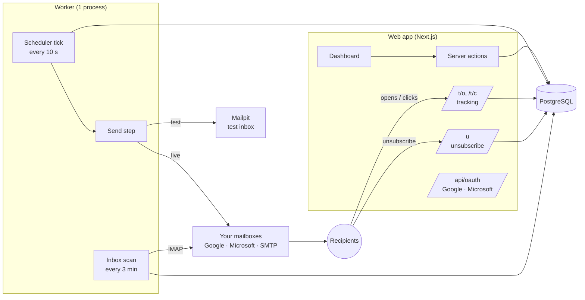

# Architecture

Two processes share one database:

- **Web app** (`next start`): dashboard, imports, settings, and the public endpoints recipients hit (tracking pixel, click redirect, unsubscribe page).
- **Worker** (`npm run worker`): the only thing that sends. Exactly one should run; extra copies stay on standby (leadership is a database heartbeat, so a crashed worker is replaced within ~45 s).

Sending uses plain SMTP and reading uses IMAP for every provider. Google and Microsoft authenticate with OAuth tokens (XOAUTH2) instead of passwords, so one code path covers all mailboxes.

## Data model

| Table | Holds |
|---|---|
| `Mailbox` | A sending account, its encrypted credentials, limits, warm-up, health |
| `Campaign` | Mode (TEST/LIVE), status, sending window, pacing, tracking and stop rules |
| `CampaignStep` | Email 1, 2, 3… and the delay before each; fallback copy |
| `Contact` | A person across all campaigns; global unsubscribe/bounce flags |
| `CampaignContact` | One contact in one campaign: assigned mailbox, per-contact copy from the sheet, current step, when the next email is due, outcome |
| `Message` | Every email sent: rendered copy, Message-ID, tracking token, first open/click/reply/bounce |
| `Event` | Timeline: sent, open, click, reply, auto-reply, bounce, unsubscribe, stopped, failed |

## How the scheduler decides what to send

Every tick, for each running campaign, it sends **at most one** email, and only when all of these hold:

1. The campaign's sending window is open (its time zone, days, hours).
2. The campaign's random gap since its previous email has passed (default 90–270 s, so 20/hour on average).
3. The campaign has sent fewer than its hourly limit in the last 60 minutes.
4. Some contact is due (`nextStepAt` ≤ now) and its mailbox is active, has rested 2–6 minutes since its own last email, and is under its hourly and daily limits (daily limit grows during warm-up).

Follow-ups are picked before first emails so sequences stay on schedule. After a send, the next step's due time is set to now + that step's delay.

Test campaigns with **fast-forward** skip rules 1, 3 and 4's limits, use 3–8 s gaps, and treat each "day" of delay as one minute.

## Outcomes

| Event | Detected by | Effect |
|---|---|---|
| Open | Tracking pixel | Recorded unless it looks automated (scanner user agent, or within 3 s of sending) |
| Click | Redirect link | Recorded unless automated (scanner, or within 15 s); also counts as an open |
| Reply | Inbox scan: `In-Reply-To`/`References` match our Message-ID, else sender address | Contact → Replied, no more emails; optionally colleagues at the same domain → Stopped |
| Out-of-office | `Auto-Submitted` header or subject | Logged only; sequence continues |
| Bounce | SMTP rejection while sending, or a bounce report in the inbox | Contact → Bounced, address added to the do-not-email list; mailbox auto-pauses if > 5% of its last 50 emails bounced |
| Unsubscribe | Link in the opt-out line or the mail app's one-click button | Contact stopped in every live campaign, added to do-not-email list |
| Send failure | SMTP error | Login problems mark the mailbox "Needs attention" and its contacts wait; temporary errors retry after 15, 30 min, then give up |

## Security

- Mailbox passwords and OAuth tokens are encrypted with AES-256-GCM (`ENCRYPTION_KEY`).
- Sessions are signed HTTP-only cookies; every page except tracking, unsubscribe and health requires sign-in.
- Click redirects only go to URLs that were in the email that was sent (no open redirect).
- Unsubscribe GET shows a confirmation button so link scanners cannot unsubscribe people; POST performs it (RFC 8058 one-click).
- Contact sheets are never stored as files; `.xlsx`/`.csv` are git-ignored.
